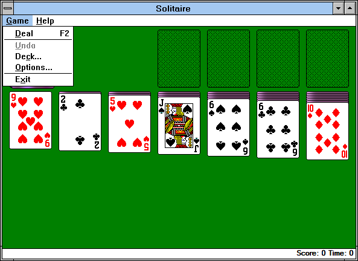
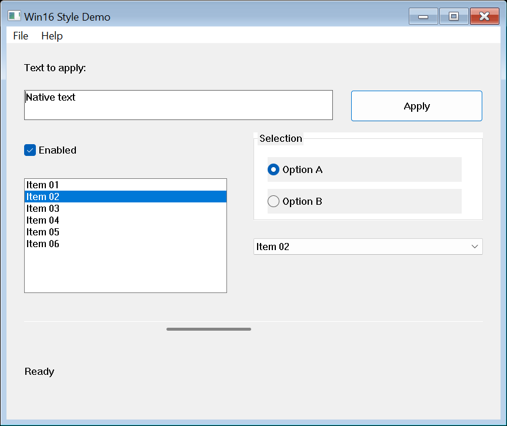
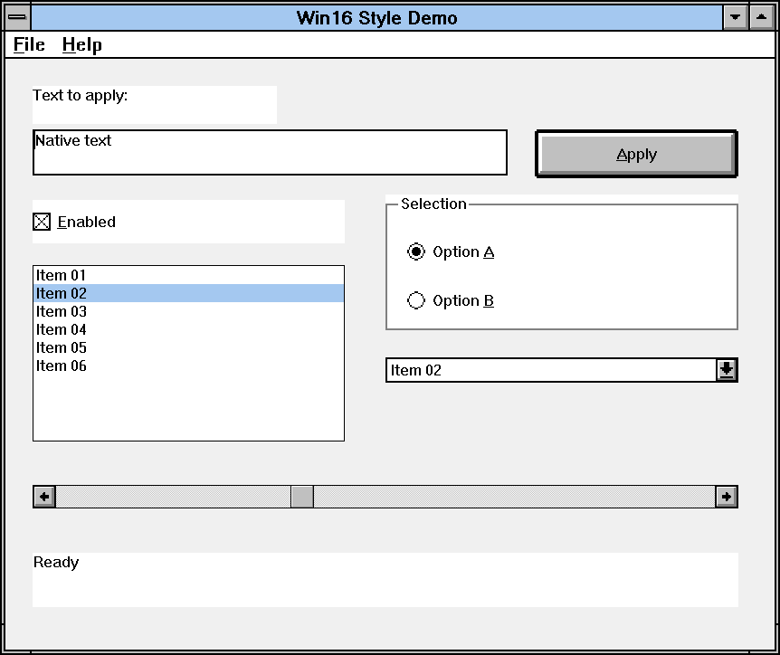
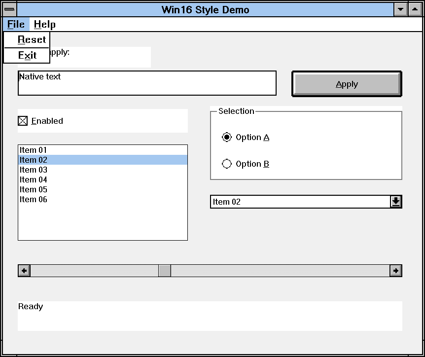
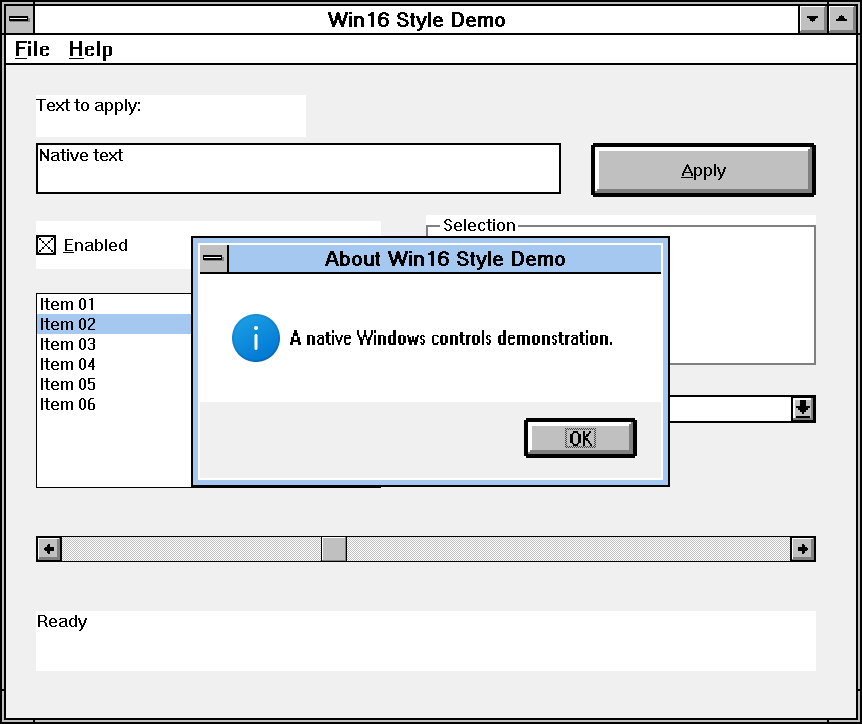
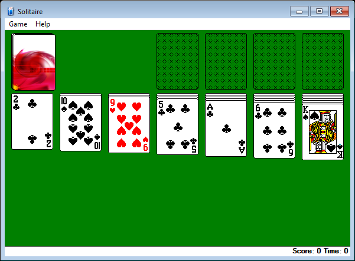
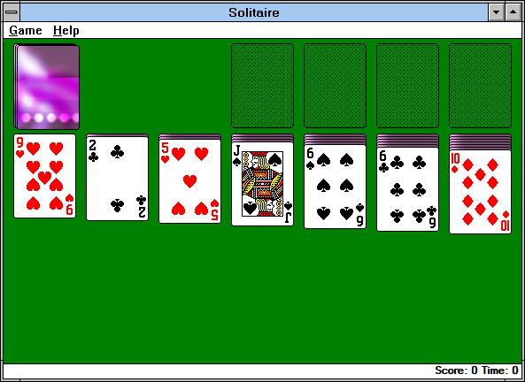
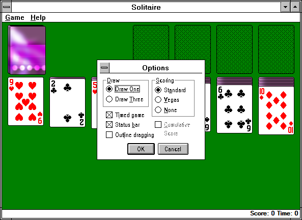

# Win16 Style

**Windows 3.1-style windows for native Win32 and Win64 applications.**

Launch an application with `run16s.exe` to give its supported windows, menus,
and controls a classic Win16 appearance. The application runs natively on
Windows, with the same executable and application logic.



*Real Windows XP Solitaire, running as a 32-bit application through the current
Win16 Style launcher. The cards, game board, and Score/Time display are drawn by
Solitaire itself.*

[Quick start](#quick-start) · [Screenshots](#screenshots) ·
[How it works](#how-it-works) · [Build](#build-from-source) ·
[Compatibility](#compatibility-and-scope) · [Licenses](#licenses-and-origins)

## Quick start

Use a modern **64-bit Windows** host. Get the four files from
[assets](assets/README.md) and keep them together in one directory:

| File | Architecture | Purpose |
| --- | --- | --- |
| [run16s.exe](assets/run16s.exe) | x64 | Starts an application and installs the matching styling DLL. |
| [ntw16s32.dll](assets/ntw16s32.dll) | x86 | Styles 32-bit applications and propagates hooks to descendants. |
| [ntw16s64.dll](assets/ntw16s64.dll) | x64 | Styles 64-bit applications and propagates hooks to descendants. |
| [demo.exe](assets/demo.exe) | x64 | A native Windows controls demo for direct comparison. |

From that directory, in PowerShell:

```powershell
# Run the demo with its normal Windows appearance.
.\demo.exe

# Run the exact same demo with Win16 Style.
.\run16s.exe .\demo.exe

# Launch your own 32-bit or 64-bit desktop application.
.\run16s.exe "C:\Games\Solitaire\sol.exe"
```

Solitaire is an example, not part of the package. Use your own copy; the Windows
XP version also uses its matching `cards.dll` beside `sol.exe`.

### Waiting and child processes

```powershell
# Console targets wait by default and return their exit code.
.\run16s.exe cmd.exe

# Wait explicitly for a GUI target and return its exit code.
.\run16s.exe --wait .\demo.exe
```

GUI targets normally return control to the launcher caller after startup.
`--wait` waits for the initial target, rather than every descendant. The
launcher keeps the Console subsystem so an interactive `cmd.exe` naturally
waits for it.

Styling is enabled by default. Supported descendants created with
`CreateProcessA/W` receive the appropriate x86 or x64 DLL too; a 32-bit child can
follow a 64-bit parent, or vice versa. There is no extra `--win16-style-all` flag.

## Screenshots

These are captures of **real application windows** using the checked-in
four-file package. Click any image for its original resolution.

### One demo executable, two appearances

The demo contains standard buttons, an edit box, checkboxes, radio buttons,
a list box, a combo box, and a horizontal scrollbar. It does not implement a
second skin or detect whether it should draw in Win16 Style.

| Direct launch: `demo.exe` | Styled launch: `run16s.exe demo.exe` |
| :---: | :---: |
| [](docs/etc/screenshots/demo-native.png) | [](docs/etc/screenshots/demo-styled.png) |

### Classic menus and dialogs

The original window-button and control graphics are retained. Menus use
proportionally scaled System bitmap glyphs, flat selection, thin borders,
mnemonics, and aligned shortcut columns. Standard dialogs receive the same
window treatment.

| Demo menu | Demo About dialog |
| :---: | :---: |
| [](docs/etc/screenshots/demo-menu.png) | [](docs/etc/screenshots/demo-about.png) |

### A real 32-bit application: Windows XP Solitaire

The same `sol.exe` runs directly or through `run16s.exe`. Its custom-painted game
board remains application-owned. Each launch deals a new game, so cards and
animated card backs can differ between captures.

| Direct launch | Through Win16 Style |
| :---: | :---: |
| [](docs/etc/screenshots/solitaire-native.png) | [](docs/etc/screenshots/solitaire-styled.png) |

| Game menu | Options dialog |
| :---: | :---: |
| [](docs/etc/screenshots/solitaire-menu.png) | [](docs/etc/screenshots/solitaire-options.png) |

The demo reports 144 DPI; the DPI-unaware XP Solitaire reports 96 DPI. Captures
use native `PrintWindow` on an owned private desktop. Open menus and dialogs
are captured separately and placed at their actual window coordinates; dialogs
were centered within their owner before capture. The images are not mockups or
full-desktop compositor captures. See [capture details](docs/etc/screenshots/README.md)
for application versions, package hashes, and image provenance.

## How it works

```text
run16s.exe (x64)
  |
  +-- application.exe (x86 or x64)
        +-- ntw16s32.dll or ntw16s64.dll
        +-- supported child processes receive matching hooks
```

The launcher creates the target suspended, installs the DLL matching the target
architecture, then releases the suspension it added. The DLL handles window
styling and supported descendant propagation inside that process.

The project has **three components and four product files**: a launcher, a
single styling/injection implementation built for two architectures, and a
native demo. It does not require NTVDM, a background service, or a system-wide
theme change.

Supported presentation includes classic title bars and system buttons, menu
bars and popups, common standard controls, and scrollbars with square end
buttons. Application-drawn content remains the application's responsibility.

## Build from source

The implementation and native tests use **C17**, **MinGW-w64 GCC**, **Ninja**,
and **ccache**. CMake generates the Ninja builds. No C++ or MSVC is required.
MSYS2 can supply the tools; the resulting applications do not require the MSYS
runtime.

On x64 Windows, prepare:

- Native x86 and x64 MinGW-w64 GCC toolchains, with matching resource tools.
- CMake 3.25 or later, Ninja, and ccache.
- Python 3 and PowerShell 7.

From the repository root:

```powershell
pwsh -NoProfile -File tools/Build-Package.ps1 -RunName local-build
```

The script starts a hidden worker, copies the sources into an isolated clean
build tree, builds both architectures, and assembles the four-file candidate at:

```text
build/t8-package/local-build/candidate/
```

Wait for the worker to finish and inspect
`build/t8-package/local-build/result.json`; a returned worker PID is not a
successful build result. Use a fresh run name for subsequent builds. If toolchain
discovery needs help, set `WIN16STYLE_GCC32` and `WIN16STYLE_GCC64` to the two
native GCC executables.

Test that exact candidate package:

```powershell
pwsh -NoProfile -File tools/Test-Package.ps1 -RunName local-test `
  -Package build/t8-package/local-build/candidate `
  -BuildRoot build/t8-package/local-build/clean-source/build/.ninja `
  -SourceRoot build/t8-package/local-build/clean-source
```

This also runs in a background worker; inspect its final result under
`build/t8-package/local-test/`. Building and testing do not automatically install
or publish the candidate. Detailed [build notes](docs/etc/operations/BUILD.md)
and [test documentation](tests/README.md) are available in Chinese.

## Compatibility and scope

- Targets are native **x86/x64 Windows desktop PE applications**. This project
  changes appearance; it does not execute DOS or 16-bit Windows binaries.
- Standard Windows UI is the primary target. Custom-drawn interfaces can retain
  their own appearance; styling is not universal across every application.
- The System bitmap font path covers CP1252. Other scripts and arbitrary font
  sizes are outside the bitmap fidelity claim.
- Keep the package together. Its directory must round-trip through the Windows
  ANSI code page or have a usable short path; not every Unicode package path is
  supported.
- ARM64, protected/elevated targets, and unsupported process-creation APIs are
  outside the current validated scope.

The current binaries, hashes, and validation boundaries are recorded in the
[release manifest](docs/etc/release.json). Active work is tracked in
[CURRENT](docs/states/CURRENT.md); historical test results are not a promise that
every application or DPI configuration has been validated.

## Licenses and origins

Win16 Style separates the native application styling part of
[ntvdm64](https://github.com/cshaxu/ntvdm64), originally exposed as
`run16 --win16-style-all`, into an independent project.

Project-authored code is covered by the [MIT license](LICENSE). The bundled
MinHook/HDE code retains its [BSD license and notices](src/ntw16s-dll/injection/minhook/LICENSE.txt).

Historical Windows graphics retain their original bytes and
[resource provenance](src/ntw16s-dll/resources.md). They are Microsoft artwork,
not relicensed project artwork; the retained notice states that public
redistribution rights have not been established. The project license does not
override those notices. Microsoft Windows and Solitaire remain their owners'
software; no Solitaire executable or `cards.dll` is included here.

## Contributing

See [CONTRIBUTING](CONTRIBUTING.md) and the [documentation guide](docs/README.md)
for the repository workflow. Maintainer documentation is mostly in Chinese;
this README is the English entry point for users and contributors.
